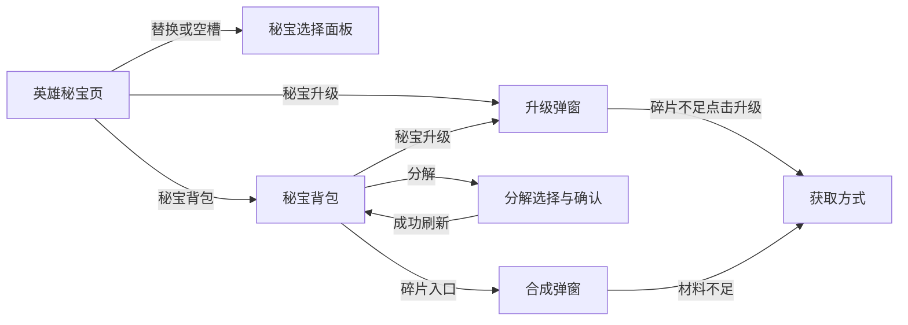
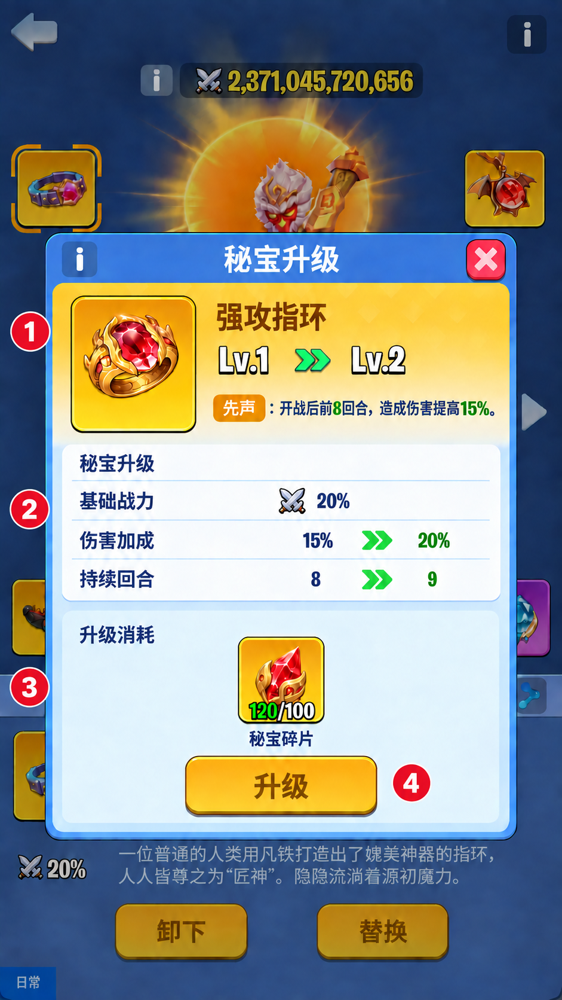
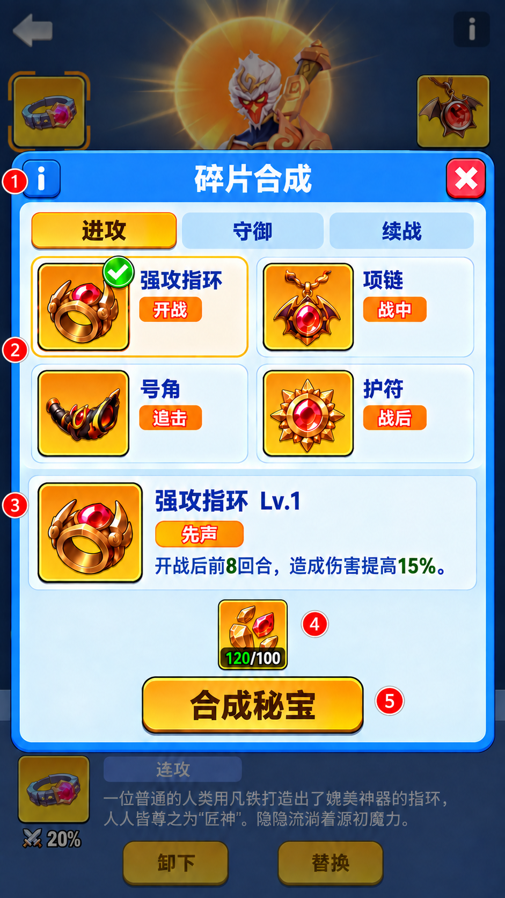
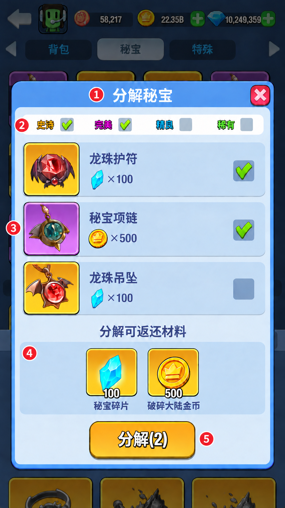
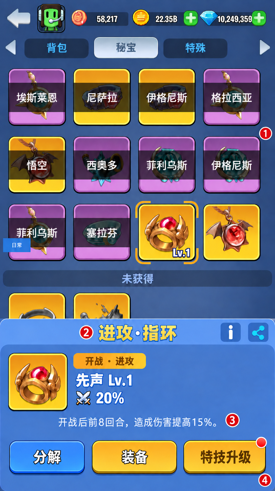

# 秘宝时序特技 · 界面派生文档

本文承接主案的界面设计，覆盖五个已有图的核心界面。业务判定见[主案](秘宝时序特技.md)，本文维护展示、交互、状态与文案。

原图与标注图均保留。标注编号、坐标为视觉估计，请结合原图核对。旧图尚未重制的文字差异在每屏说明中明确，正式规则以最新确认内容为准。

# 界面与流程

| 界面 | 标识 | 入口 | 图稿状态 |
|---|---|---|---|
| 英雄界面·秘宝页 | treasure_main | 英雄界面 | 已有图，移除已取消入口，名称及详情排版待统一 |
| 秘宝升级弹窗 | treasure_merge | 英雄秘宝页／秘宝背包 | v9秘宝升级，基础战力并入属性列表 |
| 碎片合成弹窗 | treasure_shard | 背包碎片项／商店合成入口 | v3高清重制，候选信息精简、底部分数消耗 |
| 秘宝分解弹窗 | treasure_decompose | 秘宝背包分解按钮 | v2图标数量版 |
| 秘宝背包 | treasure_bag | 现有背包秘宝页签 | v2等级效果操作版，名称与排版待统一 |

标识沿用既有策划文档，只用于文档定位。秘宝仓库业务并入秘宝背包，选择与分解确认位于同一弹窗。

流程图只展示主要入口。关闭、失败、刷新等分支以每屏状态表为准。

# 共用展示规范

| 要素 | 展示规范 |
|---|---|
| 道具名称 | 使用包装名，已确认示例为强攻指环。其余名称读取配置，不临时编造整套命名。 |
| 单件效果 | 技能名用有色底标签，后接完整效果描述。正文深蓝，效果参数及百分号绿色。单件只展示其固定技能。 |
| 等级 | 新特技秘宝显示实例等级。升级弹窗右侧已显示等级变化时，道具图标内不重复叠等级。 |
| 材料 | 升级与返还使用小道具卡及名称；合成仅显示小图标与下沿分数。碎片图标统一读取正式道具配置。 |
| 数量 | 消耗按库存/本次所需显示一次。返还条目按资源图标×数量显示，汇总按道具卡数量展示。 |
| 通用规则 | 触发次数、升级范围与全额返还收进i说明，操作面板只保留当前效果与本次结果。 |
| 按钮与遮罩 | 主按钮四周留出明显空隙，不能贴住面板边界。弹窗背景使用压暗遮罩，保留原画面清晰度。 |
| 示例数值 | 等级、15%→20%、8→9回合、120/100、返还100/500为图稿示例，正式值由配置与实例状态决定。 |

# 英雄界面·秘宝页

从英雄界面进入，默认展示该英雄当前穿戴及所选秘宝。点击有秘宝的槽位切换下方详情，空槽或替换操作进入现有秘宝选择流程。

**图稿使用说明**：源图用于位置对照。落地时将示例名称统一为强攻指环，详情采用有色技能名标签与数值分色。图中秘宝仓库入口接入现有秘宝背包并改用对应文案。旧图右侧「部队特技」按钮已取消，落地时移除；不再制作对应预览弹窗。

[原图](ui-annotation/assets/treasure-stunt/treasure_main.png) · [标注数据](ui-annotation/assets/treasure-stunt/treasure_main_annotated.json)

<table class="ui"><colgroup><col style="width:40%"><col style="width:60%"></colgroup><tr><td style="vertical-align:top;background:#E8F2FE"></td><td style="vertical-align:top;background:#FFFAE5"><ol><li><b>页面与战力</b><ul><li>保留角色、战力、返回和规则入口。战力显示沿用现有口径，界面不重复铺陈基础战力不变等规则。</li><li class="key"><code>Treasure_System_Treasure</code></li><li class="key"><code>Treasure_System_Power</code></li><li class="key"><code style="color:#FE0300">TreasureStunt_ruleTitle</code></li><li class="key"><code style="color:#FE0300">TreasureStunt_rule</code></li></ul></li><li><b>穿戴槽位与辅助入口</b><ul><li>同类四槽合并标注。新特技秘宝显示实例等级，选中框只对应一件秘宝。存量秘宝保留原词条且不补造等级。</li><li>秘宝背包入口打开已有秘宝页签，回到本页保留当前英雄。</li><li class="key"><code style="color:#FE0300">TreasureStunt_level</code></li><li class="key"><code style="color:#FE0300">TreasureStunt_bag</code></li></ul></li><li><b>选中秘宝标题</b><ul><li>显示配置对应的包装名。示例名称采用已确认用语，分类或功能定位不代替道具名。信息与分享沿用原控件。</li><li class="key"><code style="color:#FE0300">TreasureStunt_ring</code></li></ul></li><li><b>等级、战力与完整效果</b><ul><li>显示当前特技等级、基础战力加成与该件固定效果。技能名采用有色底标签，描述中的数值与正文分色。</li><li>单件详情只显示该件技能，不展开部队四节点。新特技和存量词条按对象类型显示，具体口径见主案。</li><li class="key"><code style="color:#FE0300">TreasureStunt_skill</code></li><li class="key"><code style="color:#FE0300">TreasureStunt_level</code></li><li class="key"><code style="color:#FE0300">TreasureStunt_effectFirstStrike</code></li></ul></li><li><b>操作按钮</b><ul><li>已穿戴实例显示卸下、替换、秘宝升级。点击升级直接打开升级弹窗。</li><li>卸下和替换沿用驻防限制。升级可用性与红点见升级弹窗及共用状态。</li><li class="key"><code>Treasure_System_Remove</code></li><li class="key"><code>Treasure_System_Replace</code></li><li class="key"><code style="color:#FE0300">TreasureStunt_upgrade</code></li></ul></li></ol></td></tr></table>

## 状态与反馈

| 状态 | 界面反馈 |
|---|---|
| 已穿戴新秘宝 | 展示当前实例等级和固定效果，提供卸下、替换、升级。 |
| 空槽或无可穿戴项 | 沿用空槽入口。候选为空时使用现有无可装备提示。 |
| 存量秘宝 | 沿用原词条，不显示新特技等级和升级入口。 |
| 部队出征中 | 保持详情可查看，受限操作反馈回城驻防提示。 |

# 秘宝升级弹窗

从英雄秘宝页或秘宝背包的秘宝升级按钮进入，始终绑定被点击的秘宝实例。i 打开规则说明，关闭返回来源界面。

**图稿使用说明**：采用 v9 秘宝升级属性列表版。基础战力移入列表，与伤害加成、持续回合并列；弹窗与列表标题统一为秘宝升级。效果、等级、消耗和按钮内容以本节为准。背景保持清晰并压暗，按钮与面板边框保留明显留白。

[原图](ui-annotation/assets/treasure-stunt/treasure_merge.png) · [标注数据](ui-annotation/assets/treasure-stunt/treasure_merge_annotated.json)

<table class="ui"><colgroup><col style="width:40%"><col style="width:60%"></colgroup><tr><td style="vertical-align:top;background:#E8F2FE"></td><td style="vertical-align:top;background:#FFFAE5"><ol><li><b>秘宝、等级与当前效果</b><ul><li>道具大图旁展示包装名及当前→下一级等级。大图内不再叠放重复等级，名称下不重复展示开战/进攻定位标签。</li><li>技能名放在有色底标签内，与完整效果描述相连。正文深蓝，效果数值绿色。示例为当前Lv.1，不能把下一级参数提前写入当前描述。</li><li class="key"><code style="color:#FE0300">TreasureStunt_ring</code></li><li class="key"><code style="color:#FE0300">TreasureStunt_level</code></li><li class="key"><code style="color:#FE0300">TreasureStunt_skill</code></li><li class="key"><code style="color:#FE0300">TreasureStunt_effectFirstStrike</code></li></ul></li><li><b>秘宝升级属性列表</b><ul><li>弹窗标题与列表标题统一为秘宝升级。基础战力、伤害加成、持续回合在同一列表逐行显示，秘宝大图中不再重复展示战力。</li><li>基础战力行显示战力图标与当前加成，例20%，读取所选秘宝配置；不显示变化箭头、下一级数值或不变等说明。</li><li>特技参数显示当前值→下一级值；当前值深蓝，下一级值绿色。例图伤害加成15%→20%、持续8→9回合，正式值读取等级配置。秘宝升级的命名调整不改变原有培养规则。</li><li class="key"><code style="color:#FE0300">TreasureStunt_improve</code></li><li class="key"><code style="color:#FE0300">TreasureStunt_basePower</code></li><li class="key"><code style="color:#FE0300">TreasureStunt_damage</code></li><li class="key"><code style="color:#FE0300">TreasureStunt_rounds</code></li></ul></li><li><b>碎片消耗</b><ul><li>小尺寸道具卡居中，数量分数叠在卡片下沿，道具名置于下方。材料视觉权重低于主秘宝。</li><li>数量分数只表达库存/本次需要。库存足够绿色、不足红色。消耗区只保留这一处数量，不放重复消耗、余额推算、分数释义和单独获取提示。</li><li class="key"><code style="color:#FE0300">TreasureStunt_cost</code></li><li class="key"><code style="color:#FE0300">TreasureStunt_shard</code></li><li class="key"><code style="color:#FE0300">TreasureStunt_fraction</code></li></ul></li><li><b>升级操作</b><ul><li>足量时点击升级提交一次升一级。材料不足仍可点击同一按钮，打开碎片获取方式，不提交升级。</li><li>满级显示满级态并禁止提交，消耗区不展示下一等级的虚构需求。处理中防重复点击，成功刷新等级、效果、库存与来源页红点。</li><li class="key"><code>Skill_detail_btn_1</code></li><li class="key"><code>TECH_Common_Max</code></li></ul></li></ol></td></tr></table>

## 状态与反馈

| 状态 | 界面反馈 |
|---|---|
| 足量且未满级 | 升级可点击，成功后按结果刷新当前/下一等级。 |
| 材料不足 | 库存数字为红色，点击升级打开获取方式。返回时刷新库存及可用性。 |
| 已满级 | 显示已满级，无下一等级对比及待消耗数量，不能再次升级。 |
| 出征或实例失效 | 按实际原因提示，状态变化时刷新当前目标。 |
| 关闭／请求失败 | 关闭不消耗。失败不预演扣费或升级成功，保留可用页面并刷新实际结果。 |

# 碎片合成弹窗

从背包碎片项或商店合成入口进入，选择已解锁的新秘宝作为目标。当前背包图未展示碎片入口位置，定位复用现有道具入口，不据此新增一排控件。

**图稿使用说明**：采用2026-09-23高清重制版。标题下直接排列方向页签与候选列表；候选只显示道具图、包装名、时序标签和选中状态。底部材料只显示小图标与库存/所需分数。

[原图](ui-annotation/assets/treasure-stunt/treasure_shard.png) · [标注数据](ui-annotation/assets/treasure-stunt/treasure_shard_annotated.json)

<table class="ui"><colgroup><col style="width:40%"><col style="width:60%"></colgroup><tr><td style="vertical-align:top;background:#E8F2FE"></td><td style="vertical-align:top;background:#FFFAE5"><ol><li><b>弹窗导航</b><ul><li>保留碎片合成主标题、规则和关闭入口；关闭返回来源界面，不消耗碎片。</li><li>主标题下直接进入页签与候选列表，不重复显示选择合成秘宝。</li><li class="key"><code style="color:#FE0300">TreasureStunt_craft</code></li><li class="key"><code style="color:#FE0300">TreasureStunt_ruleTitle</code></li><li class="key"><code style="color:#FE0300">TreasureStunt_rule</code></li></ul></li><li><b>方向页签与候选秘宝</b><ul><li>进攻、守御、续战用于筛选。页签下直接排列候选卡片，选中后同步下方详情。</li><li>候选卡片只保留道具图、包装名、时序标签和选中状态；不显示等级，也不显示先声、雷霆等效果名称。开战、战中、追击、战后标签按目标节点保留。</li><li>道具名称不加进攻等类型前缀；类型已由页签表达。强攻指环为已确认包装名，其余名称读取配置。</li><li>未解锁目标不可提交并显示解锁条件。已拥有仍可按规则合成副本，不因已拥有而禁用。</li><li class="key"><code style="color:#FE0300">TreasureStunt_attack</code></li><li class="key"><code style="color:#FE0300">TreasureStunt_defense</code></li><li class="key"><code style="color:#FE0300">TreasureStunt_sustain</code></li><li class="key"><code>Treasure_System_Have_not</code></li><li class="key"><code style="color:#FE0300">TreasureStunt_locked</code></li></ul></li><li><b>选中秘宝完整效果</b><ul><li>下方详情保留包装名、初始等级、技能名标签与完整效果描述。等级只显示一处，不叠在详情图标内。</li><li>技能名采用有色底标签，正文深蓝，数值及百分号绿色。示例：先声；开战后前8回合，造成伤害提高15%。</li><li>预览使用新合成实例的初始值，不显示背包中同名已培养秘宝的等级。候选卡片的精简不影响本区完整效果。</li><li class="key"><code style="color:#FE0300">TreasureStunt_ring</code></li><li class="key"><code style="color:#FE0300">TreasureStunt_skill</code></li><li class="key"><code style="color:#FE0300">TreasureStunt_level</code></li><li class="key"><code style="color:#FE0300">TreasureStunt_effectFirstStrike</code></li></ul></li><li><b>底部碎片消耗</b><ul><li>材料在合成按钮上方居中，以小图标和库存/当前目标所需分数表示一次，例如120/100。图标下沿显示分数，不显示消耗文字或道具名。</li><li>顶部不显示碎片余额大卡、进度条或可合成件数。底部不重复写本次消耗、数量释义或合成后余额。</li><li>切换目标后刷新所需数量；库存足够显示绿色，不足显示红色。材料不足点击合成进入获取方式。</li><li class="key"><code style="color:#FE0300">TreasureStunt_fraction</code></li></ul></li><li><b>合成操作</b><ul><li>点击合成秘宝提交当前目标，消耗按配置计算。成功后刷新实际库存并展示所得秘宝。</li><li>按钮与材料卡、面板边缘保留留白。整件获得后的使用入库与穿戴承接主案，不自动替换英雄穿戴。</li><li class="key"><code style="color:#FE0300">TreasureStunt_craftButton</code></li></ul></li></ol></td></tr></table>

## 状态与反馈

| 状态 | 界面反馈 |
|---|---|
| 未选目标 | 不提交合成，先选择有效目标。 |
| 目标未解锁 | 展示解锁条件，保持不可提交。 |
| 材料足够 | 按钮可提交一次合成，成功后按实际结果刷新。 |
| 材料不足 | 点击主操作进入该碎片获取方式，返回后刷新库存。 |
| 已拥有目标 | 允许按主案合成副本，预览仍为新件初始状态。 |
| 关闭／失败 | 不扣除或不提前改变结果，失败后按实际状态刷新。 |

# 秘宝分解弹窗

点击秘宝背包的分解入口打开。该弹窗同时承载选择、返还预览和确认提交。进入时不因背包选中一件秘宝就自动执行分解。

**图稿使用说明**：采用列表图标数量版。图中勾选两件是操作过程示例。蓝色碎片与其他图中的金红色碎片均为同一道具的概念占位，落地统一读取正式道具图标。

[原图](ui-annotation/assets/treasure-stunt/treasure_decompose.png) · [标注数据](ui-annotation/assets/treasure-stunt/treasure_decompose_annotated.json)

<table class="ui"><colgroup><col style="width:40%"><col style="width:60%"></colgroup><tr><td style="vertical-align:top;background:#E8F2FE"></td><td style="vertical-align:top;background:#FFFAE5"><ol><li><b>标题与关闭</b><ul><li>关闭不提交分解，保留有效选择，返回秘宝背包，不改变资产。分解入口不直接针对背包当前选中件扣除。</li><li class="key"><code style="color:#FE0300">TreasureStunt_decomposeTitle</code></li></ul></li><li><b>品质筛选</b><ul><li>用现有品质名称与品质色，不以纯颜色代替品质文案。品质选择筛选可分解实例，切换后重新校验有效选择与预览。</li><li class="key"><code>Hero_Text_7</code></li><li class="key"><code>Hero_Text_6</code></li><li class="key"><code>Hero_Text_5</code></li><li class="key"><code>Hero_Text_4</code></li></ul></li><li><b>秘宝列表与勾选</b><ul><li>仅未装备且已入库的实例可选，逐实例展示，不能只按同名配置合并成一个选择项。</li><li>每行显示道具、名称和资源图标×该件返还数量。新特技秘宝带实际等级，存量秘宝不补造等级。</li><li>橙色行展示包含培养投入的返还总量，低品质行展示金币数量。数值都从当前结果读取。</li><li class="key"><code style="color:#FE0300">TreasureStunt_level</code></li><li class="key"><code style="color:#FE0300">TreasureStunt_count</code></li><li class="key"><code style="color:#FE0300">TreasureStunt_changed</code></li></ul></li><li><b>返还汇总</b><ul><li>选中变化时分别汇总碎片与破碎大陆金币。数量为0的资源不显示。</li><li>使用小道具卡、数量和名称展示总结果。全额返还口径放在规则说明，不另叠解释段或另开小确认窗。</li><li class="key"><code style="color:#FE0300">TreasureStunt_returns</code></li><li class="key"><code style="color:#FE0300">TreasureStunt_shard</code></li><li class="key"><code>item_name_3500001</code></li></ul></li><li><b>确认分解</b><ul><li>按钮括号中显示有效选择件数，零选择置灰。确认只提交当前批次，处理中防重复提交。</li><li>成功移除已分解项，刷新列表、背包与资源反馈。校验失败不展示成功入账，刷新后重新确认。</li><li class="key"><code style="color:#FE0300">TreasureStunt_decompose</code></li><li class="key"><code style="color:#FE0300">TreasureStunt_emptyDecompose</code></li><li class="key"><code style="color:#FE0300">TreasureStunt_changed</code></li></ul></li></ol></td></tr></table>

## 状态与反馈

| 状态 | 界面反馈 |
|---|---|
| 首次打开／未选择 | 无自动分解，按钮不可提交，无虚构返还数量。 |
| 已装备／未获得 | 不进入可选集合。背包保留英雄归属展示。 |
| 已选择 | 列表勾选、按钮件数及返还汇总一致。 |
| 无可分解项 | 列表空态，确认按钮不可提交。 |
| 状态变化 | 整批不处理，刷新无效项与预览后重新确认。 |
| 关闭／成功 | 关闭不消耗。成功后更新实例与资源，获得反馈复用现有弹窗。 |

# 秘宝背包

沿用现有背包的秘宝页签，展示已入库实例与未获得区域。选择秘宝只切换下方信息，分解作为批量流程入口。

**图稿使用说明**：源图为等级效果操作版。按最新规范将名称改为强攻指环，详情采用技能标签+完整效果及数值分色。主案中的仓库业务落在此页，不另建独立仓库网格。

[原图](ui-annotation/assets/treasure-stunt/treasure_bag.png) · [标注数据](ui-annotation/assets/treasure-stunt/treasure_bag_annotated.json)

<table class="ui"><colgroup><col style="width:40%"><col style="width:60%"></colgroup><tr><td style="vertical-align:top;background:#E8F2FE"></td><td style="vertical-align:top;background:#FFFAE5"><ol><li><b>列表与占用状态</b><ul><li>沿用资源栏和背包/秘宝/特殊页签。卡片保留品质底、英雄归属、选中框及未获得分组。</li><li>新特技秘宝卡片显示等级，存量秘宝不显示新等级。已穿戴归属不能因新增分解被移除。</li><li>升级红点、碎片可合成红点按主案刷新，存在可分解项不形成常驻提醒。</li><li class="key"><code>Shop_label_desc_03</code></li><li class="key"><code>Treasure_System_TabTitle</code></li><li class="key"><code>Category_special</code></li><li class="key"><code>Treasure_System_Have_not</code></li><li class="key"><code style="color:#FE0300">TreasureStunt_level</code></li></ul></li><li><b>选中标题与辅助操作</b><ul><li>展示包装名与现有信息、分享入口。i承接规则，名字不以方向+部位代替。</li><li class="key"><code style="color:#FE0300">TreasureStunt_ring</code></li><li class="key"><code style="color:#FE0300">TreasureStunt_ruleTitle</code></li><li class="key"><code style="color:#FE0300">TreasureStunt_rule</code></li></ul></li><li><b>当前秘宝信息</b><ul><li>与英雄穿戴页共用信息内容：等级、固定效果、基础战力加成。技能名有色底、描述中的数值分色。</li><li>卡片与详情是不同浏览层级，可各有等级。单个详情信息组内不再叠放多份相同等级和定位标签。</li><li class="key"><code style="color:#FE0300">TreasureStunt_skill</code></li><li class="key"><code style="color:#FE0300">TreasureStunt_level</code></li><li class="key"><code style="color:#FE0300">TreasureStunt_effectFirstStrike</code></li></ul></li><li><b>操作区</b><ul><li>未装备新秘宝显示装备与秘宝升级。装备承接现有英雄选择及穿戴流程，升级直接打开目标实例的升级弹窗。</li><li>分解按钮打开批量分解弹窗，不立即分解选中件。已装备、存量及未获得状态按下表收敛可用操作。</li><li class="key"><code>HeroArmor_bag_label</code></li><li class="key"><code style="color:#FE0300">TreasureStunt_upgrade</code></li><li class="key"><code>Dragon_Equip_decompose_btn</code></li><li class="key"><code>Treasure_Choose_Hero</code></li></ul></li></ol></td></tr></table>

## 状态与反馈

| 状态 | 界面反馈 |
|---|---|
| 未装备新秘宝 | 可装备，可进入升级，分解通过独立批量入口。 |
| 已装备新秘宝 | 保留英雄归属，不能作为分解材料。升级继续遵守驻防限制。 |
| 存量秘宝 | 展示原词条，不出现新特技等级与升级按钮。 |
| 未获得条目 | 展示已有未获得状态，不出现针对不存在实例的升级或分解提交。 |
| 空库存／返回刷新 | 沿用现有空页。升级、合成入库、穿戴或分解后刷新列表及详情。 |

# 配套界面与复用范围

下列界面尚无本次专用效果图，只登记主案已定义的职责、展示信息和衔接。补图后再标注控件位置。

| 界面 | 承载信息与行为 | 交付方式 |
|---|---|---|
| 秘宝选择／替换面板 | 按槽位选择候选，查看等级、技能与占用状态，承接既有穿戴限制。 | 改造现有界面，需补图 |
| 碎片获取方式 | 显示当前可用来源。返回后刷新库存，来源未开放时沿用主案的开放提示。 | 复用通用获取弹窗 |
| 规则说明 | 承载共用规则文本。旧词条保留原说明，新时序特技采用主案的节点规则。 | 复用i规则弹窗 |
| 战报特技展示 | 实际触发的节点、技能等级和影响信息，以及合规掉落结果。 | 改造现有战报，需补样例 |
| KVK商店 | 秘宝和碎片货架、解锁、限购、货币及合成入口。 | 改造现有货架，需核对状态 |

合成、升级与分解成功采用现有获得/升级反馈。失败提示使用实际返回原因，不额外增加详情中转窗口。

# 图稿一致性与补图项

| 位置 | 处理要求 |
|---|---|
| 英雄页与背包 | 将旧示例名改为已确认包装名，技能描述采用统一标签和数值分色。 |
| 碎片合成 | 已按最新图稿更新：删除顶部碎片信息与重复标题；候选去等级及效果名、保留时序；底部只显示碎片图标与分数。 |
| 全套资源 | 统一秘宝碎片和破碎大陆金币的正式图标。概念图中配色差异不代表不同道具。 |
| 分解培养件 | 补橙色高等级实例示例，行内和汇总均展示包含培养返还的正确总数。 |
| 状态图 | 补满级、材料不足、未解锁、无可分解项等状态，可使用同一界面的状态变体。 |
| 缺图界面 | 先补秘宝选择／替换，再补战报与商店展示。 |

# 本地化文本汇总

复用项已核对客户端 Assets/Res/i18n/cn.tsv。新增项采用TreasureStunt_前缀，已检查该文件不存在同名key。以下为待录入清单，未修改游戏语言表。

道具、英雄和其他技能的动态名字由现有配置绑定，本表不为每个图稿示例新增同义名称。通用资源栏、返回、分享及原有提示继续使用原控件文案。

## 复用 key（20条）

| 枚举 KEY | 中文 | 占位符传参说明 |
|---|---|---|
| Treasure_System_Treasure | 秘宝 | 无 |
| Treasure_System_Power | 秘宝战力 | 无 |
| Treasure_System_Remove | 卸下 | 无 |
| Treasure_System_Replace | 替换 | 无 |
| Treasure_System_TabTitle | 秘宝 | 无 |
| Treasure_System_Have_not | 未获得 | 无 |
| Treasure_No_Item | 无可装备秘宝 | 无 |
| Treasure_Choose_Hero | 英雄 | 无 |
| LC_ERRCODE_teasurealreadyequiped | 该秘宝已被其他英雄穿戴，请前往卸下 | 无 |
| item_name_3500001 | 破碎大陆金币 | 无 |
| Hero_Text_4 | 稀有 | 无 |
| Hero_Text_5 | 精良 | 无 |
| Hero_Text_6 | 完美 | 无 |
| Hero_Text_7 | 史诗 | 无 |
| HeroArmor_bag_label | 装备 | 无 |
| Skill_detail_btn_1 | 升级 | 无 |
| Dragon_Equip_decompose_btn | 分解 | 无 |
| TECH_Common_Max | 已满级 | 无 |
| Shop_label_desc_03 | 背包 | 无 |
| Category_special | 特殊 | 无 |

## 新增 key（28条）

右栏红色key为新增候选。多语言保持占位符数量与顺序，数值富文本颜色由显示层处理。

| 枚举 KEY | 中文 | 占位符传参说明 |
|---|---|---|
| TreasureStunt_upgrade | 秘宝升级 | 无 |
| TreasureStunt_improve | 秘宝升级 | 无 |
| TreasureStunt_basePower | 基础战力 | 无 |
| TreasureStunt_damage | 伤害加成 | 无 |
| TreasureStunt_rounds | 持续回合 | 无 |
| TreasureStunt_cost | 升级消耗 | 无 |
| TreasureStunt_shard | 秘宝碎片 | 无 |
| TreasureStunt_ring | 强攻指环 | 无 |
| TreasureStunt_skill | 先声 | 无 |
| TreasureStunt_bag | 秘宝背包 | 无 |
| TreasureStunt_craft | 碎片合成 | 无 |
| TreasureStunt_craftButton | 合成秘宝 | 无 |
| TreasureStunt_attack | 进攻 | 无 |
| TreasureStunt_defense | 守御 | 无 |
| TreasureStunt_sustain | 续战 | 无 |
| TreasureStunt_decomposeTitle | 分解秘宝 | 无 |
| TreasureStunt_returns | 分解可返还材料 | 无 |
| TreasureStunt_emptyDecompose | 暂无可分解秘宝 | 无 |
| TreasureStunt_changed | 秘宝状态已变化，请重新选择 | 无 |
| TreasureStunt_returnGarrison | 请等待部队回城驻防后操作 | 无 |
| TreasureStunt_locked | 尚未解锁 | 无 |
| TreasureStunt_ruleTitle | 秘宝规则 | 无 |
| TreasureStunt_effectFirstStrike | 开战后前{0}回合，造成伤害提高{1}%。 | {0}=当前等级持续回合，例8；{1}=当前等级伤害加成的百分数，例15，不传%号。参数按配置逐等级刷新，显示时仅参数及其%号着色。 |
| TreasureStunt_level | Lv.{0} | {0}=当前或下一等级整数，例1、2。存量无特技等级秘宝不调用。 |
| TreasureStunt_fraction | {0}/{1} | {0}=当前库存；{1}=本次合成或升一级所需碎片，例120/100。仅{0}随足量/不足变绿/红。 |
| TreasureStunt_count | ×{0} | {0}=该行秘宝对应返还数量，例100或500。资源图标由道具配置提供。 |
| TreasureStunt_decompose | 分解({0}) | {0}=本次选择的有效秘宝实例件数，例2。 |
| TreasureStunt_rule | 新秘宝按开战、战中、追击、战后节点触发特技，同节点不同特技均可生效，同名仅取最高等级。同级依次取主将、第一副将、第二副将。\n每场战斗中，每支部队的每种时序特技最多触发一次。\n秘宝升级只消耗秘宝碎片，仅提升特技效果，基础战力加成不变。\n橙色秘宝分解全额返还基础碎片价值与累计升级投入。\n低品质秘宝分解仅获得破碎大陆金币。\n已装备秘宝需先卸下才能分解。 | 无。此处只登记扩展规则文案。存量词条说明保留其原入口和含义，不将新特技取值规则套用于存量秘宝。 |
